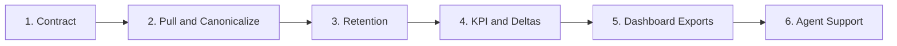

::: {.callout-important}
## Working Rule
Scripts enforce production behavior. Agents advise only.
:::

## Purpose

This Quarto document is the presentation-oriented version of the weekly NVLH/NVLAX parametric plan. It is meant for review, sharing, and side-by-side comparison with the notebook and markdown versions, while remaining executable later if charts or validation snippets need to be added.

## At a Glance

::: {.columns}
::: {.column width="50%"}
### Scope
- Weekly NVLH/NVLAX parametric operating model
- Pull, canonicalize, retain, analyze, publish
- Dashboard-facing outputs included
:::

::: {.column width="50%"}
### Immediate Objective
- Freeze the workflow before implementation
- Separate reusable skills from missing skills
- Define a presentable, shareable execution plan
:::
:::

## Plan Summary

| Step | Aim | Required Inputs / Data | Deliverable | Required Skill | Notes / Dependency |
|:---|:---|:---|:---|:---|:---|
| 1. Lock weekly contract | Define what a valid weekly run must produce | Weekly workflow, manifest schema, status model, canonical schema rules | Run contract with request ID, manifest row, canonical weekly artifact, status definitions | `nvlh-weekly-upsvf-ilas-merge` | Foundational |
| 2. Agent support layer | Add advisory review for anomalies without controlling production actions | Manifest records, anomaly flags, row-count deltas, ILAS coverage, error summaries | Data-quality triage workflow and prompt contract | `weekly-data-quality-triage` | Depends on contract |
| 3. Automatic data pull | Make weekly acquisition deterministic and recoverable | AQUA access, scheduler entry point, UPSVF pull logic, ILAS enrichment path, validation gates | Stable scheduled weekly pull with validated canonical output | `aqua-cli`, `ilas`, `nvlh-weekly-upsvf-ilas-merge` | Depends on contract |
| 4. Data retention | Preserve trend history and dashboard evidence while pruning temporary artifacts | Output classes, retention windows, policy versioning, open-issue references | Retention matrix and lifecycle rules by artifact type | `retention-policy-enforcer` | Depends on contract and pull |
| 5. Basic analysis outputs | Produce minimum useful weekly decisions before full dashboard rollout | Canonical weekly dataset, prior retained weeks, thresholds, domain/parameter mapping | KPI summary table, delta table, heat-map source, issue-seed draft, weekly summary | `weekly-kpi-builder`, `weekly-delta-analyzer` | Depends on canonical dataset |
| 6. Dashboard skill buildout | Split the workflow into reusable dashboard-facing capabilities | Existing skills inventory, KPI outputs, dashboard data model, issue/evidence structure | Ordered skill roadmap for dashboard-facing automation | `dashboard-heatmap-publisher`, `issue-seed-generator`, `weekly-narrative-reporter` | Depends on analysis outputs |

## Roadmap View

## Skill Map

::: {.columns}
::: {.column width="50%"}
### Reuse Now
- `aqua-cli`
- `ilas`
- `nvlh-weekly-upsvf-ilas-merge`
- `trace-parametric-data-tool`
- `nvlh-schema-token-resolution`
- `nvlh-normalization-vf-builder`
- `nvlh-limiter-temperature-builder`
:::

::: {.column width="50%"}
### Build Next
1. `weekly-kpi-builder`
2. `weekly-delta-analyzer`
3. `dashboard-heatmap-publisher`
4. `issue-seed-generator`
5. `weekly-narrative-reporter`
6. `retention-policy-enforcer`
7. `weekly-data-quality-triage`
:::
:::

## Phase Order

1. Contract
2. Pull and canonicalize
3. Retention
4. KPI and deltas
5. Dashboard exports
6. Agent support

## Open Decisions

- Final canonical schema and storage format
- Threshold values for Streams 1, 2, and 6
- Retention exceptions for open issues and investigations
- First dashboard publish path and ownership

## Execution Placeholders

### Validation Commands
Pending definition after the weekly contract and canonical schema are frozen.

### Latest Weekly Run
No execution recorded in this document yet.

### Open Risks
To be updated during implementation and first validation runs.

### Decision Log
To be appended as scope, thresholds, and retention rules are finalized.

## Source Notes

- Editable plain-text source remains available in [development/Weekly_Parametric_Analysis_Plan.md](c:/Users/hmarkovi/Downloads/NVLH_Parametric-main/NVLH_Parametric-main/development/Weekly_Parametric_Analysis_Plan.md).
- Notebook comparison copy remains available in [development/Weekly_Parametric_Analysis_Plan.ipynb](c:/Users/hmarkovi/Downloads/NVLH_Parametric-main/NVLH_Parametric-main/development/Weekly_Parametric_Analysis_Plan.ipynb).